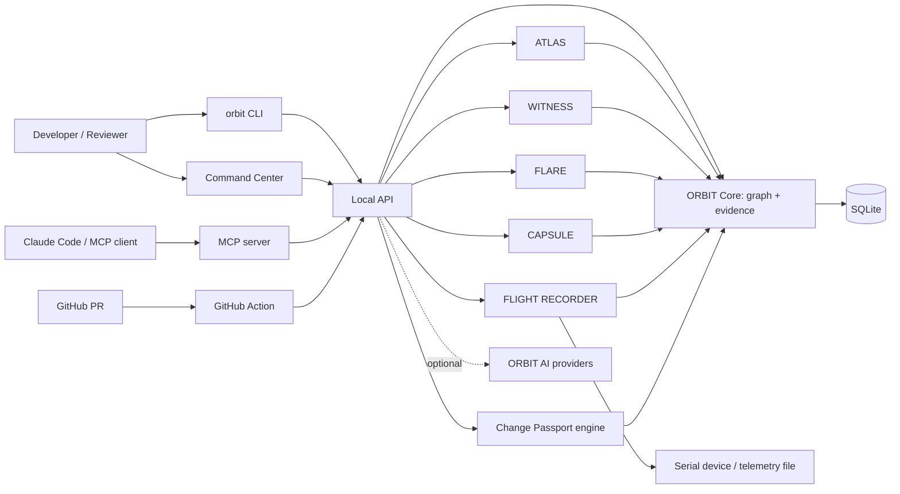
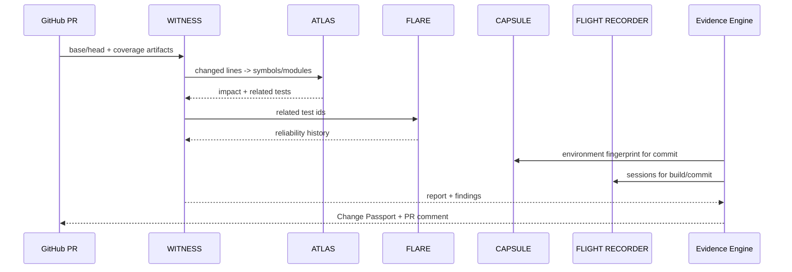

# ORBIT — Architecture

Version: 0.1 (planning, to be finalised in Prompt 1) · Date: 2026-11-07

## 1. Principles

- Modular: each engine is an independently testable package behind a small interface.
- Local-first: SQLite file per workspace; no hosted backend required.
- One evidence schema: engines write `Evidence` and graph entities through `@orbit/core` only.
- Deterministic first: AI sits on top of stored evidence and is optional.
- Least privilege: read-only by default; execution and device access need explicit approval.

## 2. System context



## 3. Package layout (proposed)

```
apps/
  web/            React + Vite + Tailwind Command Center
  api/            Fastify local API
  cli/            Commander CLI (`orbit`)
packages/
  shared/         types, errors, logging, config, path safety, redaction
  core/           node/edge/evidence interfaces, hashing, provenance
  database/       Drizzle schema, migrations, repositories (SQLite)
  graph/          traversal, queries, temporal views
  evidence/       correlation, completeness rules, passport assembly
  atlas/          scanning, parsing, architecture, memory
  witness/        diff, coverage adapters, findings, SARIF
  flare/          test-report adapters, flakiness statistics
  capsule/        environment detection, fingerprint, replay
  flight-recorder/ transports, parsers, sessions, anomalies
  mcp/            MCP server and tools
  ai/             provider adapters, specialist agents, orchestration
  github/         Action runtime, PR comments, annotations
  ui/             shared React components
firmware/examples/   small ESP32/STM32 sample sources
fixtures/            demo-repository, test-results, hardware-telemetry
docs/
```

Dependency direction: `apps/*` → engines → `evidence`/`graph` → `core`/`database` → `shared`. Engines never import each other; cross-engine joins happen only in `evidence` via graph relationships.

## 4. Engine interfaces (draft)

```ts
interface Engine {
  id: 'atlas' | 'witness' | 'flare' | 'capsule' | 'flight-recorder';
  run(input: EngineInput, ctx: EngineContext): Promise<EngineResult>;
}
interface EngineResult {
  nodes: NodeInput[];
  edges: EdgeInput[];
  evidence: EvidenceInput[];   // each with source, hash, limitations
  findings: FindingInput[];
  unsupported: Unsupported[];  // explicit gaps, never silent
}
```

Adapters (all pluggable): `LanguageParser`, `CoverageAdapter` (LCOV, Cobertura), `TestReportAdapter` (JUnit, pytest, Jest, Go JSON), `TelemetryTransport` (serial, file replay), `TelemetryParser` (CSV, JSON, NDJSON, key-value), `AIProvider` (Claude, OpenAI-compatible, Ollama).

## 5. Engine summaries

### ATLAS
Scan → classify → parse (tree-sitter grammars for TS, JS, Python, Java, C, C++) → extract symbols/imports/calls with location + confidence → build module and dependency graph → index Git history → incremental updates via content hashes. Memory store holds decisions/constraints with sources and versions.

### WITNESS
Git diff (base..head) → changed files/lines → map to symbols (via ATLAS) → parse coverage → compute changed-executable-line coverage → compare against base report → rules produce findings → render Markdown / JSON / SARIF 2.1.0.

### FLARE
Ingest reports → normalise to `TestRun` records → per-test history → flip count, Wilson interval, minimum-sample gating → clusters by normalised failure signature → duration trends.

### CAPSULE
Static detection from manifests, lockfiles, Dockerfiles, dev containers, Nix, CI config → fingerprint (hash over normalised facts, no secret values) → compare manifests → replay plan; replay is an approved, isolated, logged operation.

### FLIGHT RECORDER
Transport (serial/file) → line/frame parser → typed events and metrics → session store with raw artifact hash → playback and anomaly rules. Read-only; opening a port needs local approval.

### Evidence Engine / Change Passport
Given a commit: gather graph neighbourhood (ATLAS impact, WITNESS report, FLARE history for impacted tests, CAPSULE fingerprint, FLIGHT RECORDER sessions matched by build ID/commit). Apply transparent completeness rules → immutable passport with content hash.

## 6. Technology choices

| Concern | Choice | Notes |
|---|---|---|
| Language | TypeScript (strict) | Shared types across API, CLI, UI |
| Runtime | Node.js current LTS | Verify exact version at install time |
| Monorepo | pnpm workspaces + Turborepo | See ADR-0002 |
| Storage | SQLite + Drizzle ORM | See ADR-0003 |
| API | Fastify | Local only, bound to loopback |
| CLI | Commander | |
| Web | React, Vite, Tailwind | Dark-first |
| Parsing | tree-sitter | Not regex-only; see ADR-0004 |
| Tests | Vitest, Playwright | |
| MCP | Official TypeScript SDK | Pin version; v1.27.x current per research, v2 has breaking changes |
| GitHub | Octokit | Official client |
| Serial | node serialport (verify) | Needs native builds; fallback to file replay |

All versions are **unverified until Prompt 2** installs them.

## 7. Data flow for one PR



## 8. Security boundaries

- API binds to 127.0.0.1 by default; no remote exposure unless explicitly configured.
- All file reads go through a path-safe resolver confined to registered roots.
- XML parsers have external entities and DTD processing disabled; files have size and depth limits.
- Environment variable values are redacted at ingestion; only names are stored.
- MCP tools are read-only and return bounded, evidence-cited output.
- GitHub Action analyses reports and diffs; it never runs PR-supplied commands.

See `THREAT_MODEL.md`.

## 9. Extension points

New language parser, coverage format, CI/test adapter, hardware transport, MCP tool, finding rule, AI provider. Each has an interface, a contract test suite and a fixture directory.

## 10. Open design questions (resolve in Prompt 1)

1. Single SQLite file per repository vs. one per workspace.
2. How to model symbol identity across renames.
3. Serial library choice and Windows/macOS/Linux build story.
4. Whether the Action ships as a bundled JS action or a composite action.
