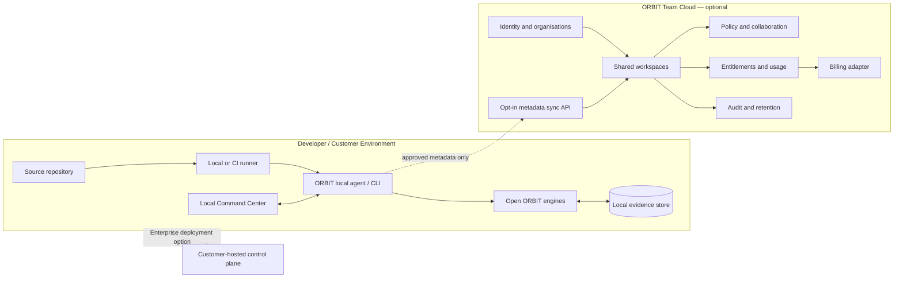

# ORBIT — Business Model & Monetization Architecture

**Status:** Strategy proposal; pricing and feature packaging are hypotheses, not commitments.  
**Last reviewed:** 2026-11-08  
**Product strategy:** Hybrid — local-first community core + hosted team collaboration + enterprise deployment + embedded-engineering add-on.

> **Evidence before confidence.** ORBIT should monetise coordination, retention, governance and support—not artificially cripple the local engineering workflow.

## 1. Executive decision

ORBIT should use a **hybrid open-core and hosted-services model**:

1. Keep the individual, local-first engineering workflow useful without an account, cloud service, AI key or subscription.
2. Charge teams for shared workspaces, cross-repository collaboration, central policy, hosted evidence retention and integrations.
3. Offer enterprise contracts for private deployment, identity controls, auditability, retention policy, procurement requirements and support.
4. Offer an embedded-engineering add-on for firmware/build/device-session linkage and telemetry workflows once those capabilities are proven end to end.

The cloud service is an optional collaboration layer. It must not become a dependency for scanning a repository, inspecting evidence or producing a local Change Passport.

## 2. Positioning

**Category:** Engineering evidence and change-verification platform.

**Positioning statement:** ORBIT connects code structure, change impact, test and coverage evidence, declared environments and recorded device sessions into a traceable engineering workflow—so teams can see what a change affects, what was actually verified and what remains unknown.

**Primary promise:** Make engineering verification easier to inspect and repeat.

ORBIT is not positioned as:
- An AI code generator.
- A replacement for the team's test framework, CI provider, source-control host or static analyser.
- A correctness, security or compliance certification.
- A magic risk score or an AI reviewer whose conclusions cannot be traced to artifacts.

A Change Passport is an evidence record with explicit limitations. It does not prove software correctness.

## 3. Customer segments and beachhead

Do not sell to everyone at launch. Start with teams that feel the cost of reconstructing evidence across tools.

| Segment | Pain to validate | Buyer / champion | Priority |
|---|---|---|---|
| Product engineering teams, roughly 5–50 developers | Reviewers repeatedly reconstruct impact, coverage, test history and environment context from different systems | Engineering manager, staff engineer, DevEx or CI lead | **Beachhead** |
| Embedded / IoT teams, roughly 3–30 engineers | Firmware changes, builds and device logs are disconnected; failures are difficult to tie back to a commit and build | Firmware lead, embedded engineering manager, test lead | **Differentiated expansion** |
| Open-source maintainers | Limited reviewer time and fragmented PR evidence | Maintainer / project sponsor | Community adoption first |
| Consultancies and software agencies | Need repeatable verification summaries across client repositories | CTO, delivery lead, quality lead | Later channel / team segment |
| Large regulated enterprises | Private deployment, governance, audit, identity, retention and support requirements | Platform engineering, security, procurement | After product and security maturity |

### Ideal first customer profile

A team that:
- Uses GitHub and a conventional CI system.
- Has multiple active repositories or a moderately complex monorepo.
- Ships frequently enough to experience recurring review and test-triage friction.
- Can nominate one technical champion and run a 2–4 week pilot.
- Is willing to share workflow feedback without requiring ORBIT to ingest source code into a hosted service.

The initial buyer is likely an engineering or DevEx leader; the day-to-day user is a developer or reviewer.

### Customer discovery questions

Before locking prices, interview at least 20–30 people across the first two segments. Ask about the last real incident, not hypothetical enthusiasm:

1. How did the team determine what a recent change affected?
2. How long did review, test triage or release investigation take?
3. Which evidence was missing or hard to trust?
4. What tools and internal scripts already solve part of this?
5. Who owns this problem and what budget can they approve?
6. What data may never leave the team's environment?
7. Would the team run a pilot on a real repository, and what outcome would justify paying?

Record current workaround, frequency, time/cost, buyer, security blocker and willingness-to-pay evidence. Do not count a friendly compliment as purchase intent.

## 4. Product and packaging architecture

### A. ORBIT Community — free, local-first

**Job:** Give an individual developer a genuinely useful engineering-evidence workflow.

Intended package:
- CLI and local API.
- Repository indexing and architecture / impact inspection.
- Local evidence graph and local storage.
- Supported diff, test and coverage report analysis.
- Local Change Passport generation and export.
- Read-only MCP access to locally indexed information.
- File-based telemetry replay and clearly labelled demo fixtures.
- GitHub Action / CI integration when the relevant implementation is release-ready.
- No account, hosted backend or AI API key required for core use.

The specific capabilities available in a release must match the shipped version and its release notes. Prototype features are not marketed as complete.

**Community boundary:** Do not impose an arbitrary repository-count or scan-count limit just to force an upgrade. A developer should be able to understand and verify their own repository without paying ORBIT.

### B. ORBIT Team — paid hosted collaboration

**Job:** Help a team share evidence and reduce repeated review and investigation work.

Planned paid capabilities, subject to implementation:
- Shared team workspaces and project membership.
- Opt-in synchronisation of selected evidence metadata and artifacts.
- Cross-repository views and team-level engineering timelines.
- Shared review workflows, comments and evidence links.
- Team policy packs and reusable verification rules.
- Configurable retention beyond the Community local workflow.
- GitHub / CI / chat integrations and notifications.
- Team usage and workflow reporting based on explainable events.
- Workspace administration, export and deletion controls.

The value being sold is collaboration and continuity—not access to basic local verification.

### C. ORBIT Enterprise — governance and deployment choice

**Job:** Satisfy larger organisations' control, security and procurement requirements.

Planned capabilities:
- Private or customer-controlled deployment options.
- SSO/SAML and SCIM provisioning.
- Role-based access control and central workspace policies.
- Audit exports, configurable retention and administrative controls.
- Data residency / private networking options where technically available.
- Approved integrations, support commitments and service-level agreements.
- Security documentation and procurement support.
- Optional dedicated onboarding and architecture support.

Do not advertise SOC 2, ISO certification, regulatory compliance or an SLA until it has actually been achieved, contracted and operationally supported.

### D. ORBIT Embedded — specialist add-on

**Job:** Connect software evidence to firmware and recorded hardware behaviour.

Planned capabilities:
- Firmware build and commit linkage.
- Device-session metadata and telemetry retention.
- Session comparison across firmware versions.
- Device / board / project organisation.
- Anomaly and reset-event investigation with source evidence.
- Exportable evidence bundles for hardware validation and release reviews.

This is a specialist add-on to Team or Enterprise, not a promise of live hardware control. Device access remains explicit, local and read-only unless a future design review changes that boundary.

### E. Optional AI — never a core dependency

AI should be an optional accelerator for summarisation or evidence navigation, not the source of truth. Support bring-your-own-provider credentials where practical. Any hosted model usage must be explicitly enabled, cost-transparent and separately metered or passed through. The core product must remain useful with AI disabled.

### F. Three-plane commercial architecture

Separate the product into three logical planes. They may share one deployment early in development, but their trust boundaries and interfaces should remain explicit.

**Local data plane — Community and Team client**
- Runs on the developer machine, CI runner or customer-controlled infrastructure.
- Scans source and builds the evidence graph.
- Runs the local engines and adapters, stores local history and generates Change Passports.
- Exposes the CLI, local API, dashboard and read-only MCP interfaces.
- Enforces file limits, path safety, repository isolation and explicit execution / serial approvals.
- Remains useful when ORBIT Cloud is unavailable.

**Cloud control plane — optional Team service**
- Owns identity, organisations, memberships, invitations and workspaces.
- Coordinates repository registrations, integrations, shared policies, collaboration and notifications.
- Manages subscription state, entitlements, usage accounting, billing-provider integration, audit events and retention settings.
- Synchronises only the approved metadata and evidence summaries required by a selected Team feature.
- Does not silently become the place where source analysis occurs.

**Enterprise deployment plane — customer-controlled option**
- Runs control-plane capabilities in a private or customer-managed environment.
- Supports customer identity, private runners, restricted egress, configurable storage and backup policy, audit export, retention and deletion workflows.
- Requires deployment, upgrade, migration, health and support tooling before it is sold.

**Data-minimisation rule:** Default sync should be limited to the minimum required metadata—for example repository identity, commit identifiers, status summaries, evidence hashes and selected passport fields. Do not upload source files, secrets, environment variable values or raw telemetry unless a customer explicitly configures and approves that data flow.

A conceptual boundary:

The diagram describes a target architecture, not implemented functionality.

### Commercial service boundaries and interfaces

Keep analysis-engine packages independent. Add these interfaces only when the corresponding milestone has passed customer validation:

| Boundary | Proposed contract | Purpose |
|---|---|---|
| Local-to-cloud sync | Versioned HTTPS API with explicit sync policy | Upload only customer-approved metadata |
| Identity | OIDC first; SAML / SCIM for Enterprise | User and organisation identity |
| Entitlements | Versioned capability document with expiry | Keep paid services decoupled from billing vendors |
| Usage metering | Idempotent usage events | Meter agreed units without reading source contents |
| Billing | Provider adapter and verified webhook handler | Avoid binding product code to one payment vendor |
| Notifications | Event interface with workspace preferences | Integrate email / chat without coupling engines |
| Audit | Append-only administrative event stream | Record policy changes, exports and integration changes |
| Deployment | Configuration-driven control-plane deployment | Cloud, private cloud or customer-hosted operation |

**Entitlement rules**
- Community functionality never requires an online entitlement check.
- Check paid capabilities at the API / service boundary, not scattered through analysis engines.
- Cache entitlements with an expiry and a documented offline grace policy.
- Cloud failure or subscription expiry must never corrupt, delete or lock local databases or locally generated evidence.
- Cancellation / downgrade may disable future hosted features after a stated grace period, but must preserve customer export and deletion rights.

**Metering rules**
- Start with active team seats and simple workspace subscriptions.
- Consider connected private repositories, hosted retention or storage bands only when pilots show they are understandable and predictably costly.
- Do not charge per symbol, graph edge, local scan or basic CLI command.
- Avoid token-based billing as the primary value metric; any optional AI cost must be explicit and separately attributable.

## 5. Monetisation and pricing hypotheses

The first commercial metric should be **active contributors in a shared workspace**, with a minimum workspace charge if support and infrastructure costs require it. This is familiar to engineering buyers and scales with the team receiving collaborative value.

Do not charge per scan, per Change Passport or per CI minute in the initial model. Avoid unpredictable bills for normal engineering activity.

| Offer | Initial pricing hypothesis | What the price covers | Status |
|---|---:|---|---|
| Community | $0 | Useful local-first individual workflow | Core promise |
| Team early-access pilot | $8–$12 per active contributor / month | Early shared workspace, selected sync, pilot support | Test only |
| Team standard | $12–$18 per active contributor / month, annual billing | Mature collaboration, integrations, team policy and agreed retention | Test only |
| Team monthly | Approximately $15–$22 per active contributor / month | Same as Team standard with monthly flexibility | Test only |
| Enterprise | Custom annual contract | Private deployment, governance, retention, support and negotiated requirements | Quote after discovery |
| Embedded add-on | Approximately $49–$199 per engineering workspace / month | Specialist device-session and telemetry workflow | Test only |

These are **hypotheses**, not published prices, forecasts or quotes. They should be changed after customer interviews, pilots, infrastructure measurements and observed support costs. Enterprise pricing should not be invented before deployment, security and support scope are known.

### Public market reference points

A snapshot of public list pricing reviewed on 2026-11-08 shows a broad range across adjacent developer tools (roughly $4–$48 per user / contributor per month among the examples with an explicit listed price):

| Product | Published reference | Why it is relevant / not directly comparable |
|---|---:|---|
| GitHub Team | $4 per user / month | Collaboration-platform price floor; not an ORBIT substitute |
| JetBrains Qodana | Active-contributor licensing (minimum 3 contributors); exact current fee should be checked against the vendor's subscription page | Code-quality / CI analysis benchmark; pricing unit is comparable, product scope is not |
| Graphite Starter | $20 per user / month, annual billing | PR workflow and team insights benchmark |
| Graphite Team | $40 per user / month, annual billing | More advanced collaboration and AI-review workflow benchmark |
| CodeRabbit Essentials | $24 per developer / month, annual billing | AI code-review benchmark |
| CodeRabbit Team | $48 per developer / month, annual billing | Higher-limit team workflow benchmark |

Sources:
- [GitHub plans and pricing](https://github.com/pricing)
- [JetBrains Qodana pricing](https://www.jetbrains.com/qodana/buy/) and [Qodana contributor-based licence rules](https://www.jetbrains.com/help/qodana/contributors.html)
- [Graphite pricing](https://graphite.com/pricing)
- [CodeRabbit pricing](https://www.coderabbit.ai/pricing)

These products differ in feature scope, billing rules, usage limits and buyer value. The figures are reference points only, not proof that ORBIT can command the same price. Prices may change and taxes, region and billing terms may apply.

### Pricing validation gate

Do not announce a permanent price until:
- At least 5 design-partner teams have used the workflow on real repositories.
- At least 3 teams have discussed a paid pilot with the budget owner.
- At least 2 teams have paid or signed a meaningful paid-pilot commitment.
- The team can explain the measurable workflow value and serve accounts without unsustainable manual support.
- Cloud cost, storage, retention and support cost have been measured from real usage.

## 6. Revenue streams

Prioritise revenue in this order:

1. **Team subscriptions:** recurring revenue from shared workspaces and collaboration.
2. **Enterprise annual contracts:** deployment, governance, retention, support and procurement.
3. **Embedded add-on:** specialist firmware/device evidence workflows.
4. **Onboarding and support:** paid setup, training and architecture assistance when customers request it.
5. **Optional AI / premium integrations:** transparent pass-through or add-on only after usage and cost are understood.

Do not depend on advertising, selling customer data, mandatory AI usage or paid access to the local core.

## 7. Privacy and trust are product requirements

The local-first principle must survive monetisation.

- No source code, telemetry or usage analytics leaves the machine by default.
- Hosted collaboration must be opt-in and must clearly show which metadata and artifacts are synchronised.
- Source content should require a separate, explicit workspace-level choice.
- Protect hosted data in transit and at rest; document subprocessors and retention.
- Provide export and deletion workflows before charging customers to store their evidence.
- Never use customer repositories, code, logs or device data to train models by default.
- Make any opt-in product analytics minimal and avoid collecting source content, secrets or personal data.
- Enterprise customers must be able to understand deployment boundaries and data flows before procurement.

If ORBIT cannot explain what leaves a customer's machine, it is not ready to sell a hosted plan.

## 8. Go-to-market architecture

### Acquisition

- Build trust through a high-quality GitHub repository, exact release notes and reproducible demos.
- Publish small demonstrations that show one real workflow: change → impact → supplied test/coverage evidence → Change Passport.
- Distribute the CLI and local workflow first; add marketplace listings only after integrations are stable.
- Make MCP documentation discoverable for developers already using coding agents.
- Publish technical articles on evidence provenance, coverage limitations, flaky-test statistics and embedded build/session traceability.
- Encourage community contributions through narrow, well-scoped issues and a clear contribution guide.
- Use design-partner referrals and engineering communities before spending on paid advertising.

### Conversion

The free workflow should lead naturally to the Team plan when several people need to share evidence, policies or retained project history. The upgrade trigger is collaboration, not an arbitrary usage cap.

### Retention

Earn recurring usage through:
- Each important PR receiving a useful and reviewable evidence summary.
- Shared knowledge that remains current and traceable.
- Repeat investigation workflows that are faster than reconstructing context manually.
- Trustworthy history that users can export and inspect.

## 9. Financial operating principles

Track actuals before building a revenue forecast.

**Revenue:** MRR, ARR, paid workspaces, active paid contributors, expansion and renewal.

**Acquisition:** qualified design partners, pilot start rate, pilot-to-paid conversion, acquisition channel and sales-cycle duration.

**Product:** time to first useful Change Passport, weekly active workspaces, repeated evidence workflows, failed/abandoned setup rate and support incidents.

**Economics:** hosting and storage cost per active workspace, support hours per account, gross margin, payment fees, AI pass-through cost and enterprise onboarding effort.

Targets should be set after the first pilot cohort. A long-term hosted gross-margin target can be modelled, but no margin is claimed until real infrastructure and support costs are measured.

## 10. Risks and mitigations

| Risk | Mitigation |
|---|---|
| Product scope is too broad | Sell one complete evidence workflow first; expand only after usage proves demand |
| Local-first architecture makes hosted monetisation harder | Charge for shared workspaces, retention, governance and integrations—not core local inspection |
| Established tools already solve individual pieces | Position ORBIT around traceable cross-engine evidence; avoid claiming uniqueness |
| Enterprise security expectations arrive too early | Defer enterprise promises until threat model, deployment and operational controls are ready |
| Embedded hardware support becomes a distraction | Validate with a small number of firmware design partners after the software workflow is sound |
| Cloud costs undermine margins | Measure artifact size, retention, sync volume and support cost; use transparent quotas |
| Brand or licence is not ready | Complete name and licence checks before public commercial launch |

## 11. Legal and release prerequisites

- ORBIT is identified as a **working codename** in the Master Plan. Check repository, package-registry, domain and trademark availability before a public brand launch.
- The repository currently states Apache-2.0 as the target licence, but the LICENSE file has not been added. Do not describe the code as Apache-2.0 licensed or grant rights until the actual licence decision and file are complete.
- Prepare privacy notice, terms, data-processing terms and support terms before hosted customer data is accepted.
- Obtain qualified legal and tax advice before company formation, paid contracts, invoicing or international sales.
- If Apache-2.0 remains the chosen licence, recognise that it permits broad commercial use of the licensed Community code; ORBIT's commercial advantage must come from hosted operations, reliability, governance, integrations and support—not exclusivity over the open-source code.
- Keep proprietary hosted-service code in clearly separated service boundaries. Publish third-party notices and meet dependency licence obligations.
- Do not introduce a CLA, copyright assignment or dual-licensing promise without qualified legal review and a clear contributor process.
- Do not claim certifications, regulatory approvals or security guarantees that have not been independently achieved.

## 12. Decision record

**Recommended model:** Free local-first Community + paid hosted Team + custom Enterprise + Embedded add-on.

**Primary initial buyer:** Engineering / DevEx lead at a 5–50 developer GitHub-centric team.

**Primary price hypothesis:** $12–$18 per active contributor / month for mature Team collaboration, to be validated.

**First commercial milestone:** A small group of teams repeatedly using a real evidence workflow, with at least two paid pilot commitments.

**Non-negotiable:** Core local inspection remains useful without an ORBIT account, subscription, hosted service or AI API key.
