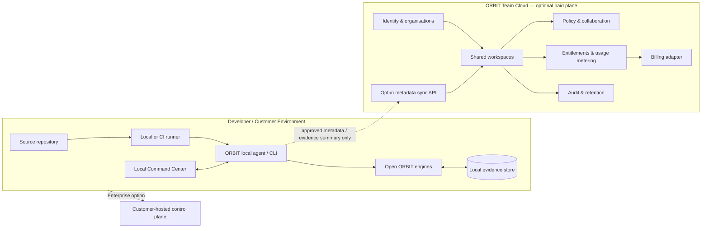

# ORBIT — Hybrid Monetization Architecture and Commercialization Roadmap

**Decision:** Hybrid  
**Status:** Proposed strategy; no billing, cloud control plane, paid entitlements, or commercial integrations are implemented.  
**Last updated:** 2026-11-08

> **Product principle:** Keep the local engineering intelligence engine genuinely useful and open. Charge for the operational value that teams and enterprises need around it: collaboration, managed coordination, governance, deployment choices, integrations, and accountable support.

This document adds a commercial workstream to ORBIT's existing engineering roadmap. It does not change the order of Prompts 5–17 or authorize commercial features before the product's evidence workflow is proven.

---

## 1. Executive decision

ORBIT will follow a **local-first open-core + paid services** model:

1. **ORBIT Community** is a capable, self-hostable local product. A developer can scan a repository, build the engineering graph, inspect evidence, and produce a Change Passport without an ORBIT account, cloud connection, or paid key.
2. **ORBIT Team** adds optional hosted collaboration and operational convenience for teams: shared workspaces, team policy, multi-repository views, collaboration, notifications, retention controls, and managed GitHub/CI integrations.
3. **ORBIT Enterprise** adds deployment and governance options for organisations: self-hosted or private control plane, SSO/SCIM, advanced RBAC, audit export, policy controls, private runners, support commitments, and custom integrations.

The first customer segment to validate is **embedded and IoT engineering teams**. Their workflow can exercise the full ORBIT story—source, build/environment, test evidence, firmware identity, and real device telemetry—while the core remains useful to ordinary software teams.

### What we are not building

- Not another AI code generator or generic AI PR reviewer.
- Not a cloud-only product.
- Not a paywall around basic local scanning, graph inspection, or evidence export.
- Not a dashboard that invents metrics or implies unimplemented features work.
- Not a data-hungry service that silently uploads source code, secrets, or raw device logs.

---

## 2. Product editions and packaging

| Capability | Community | Team | Enterprise |
|---|---|---|---|
| Local CLI, API and dashboard | Included | Included | Included |
| Local repository scanning and graph | Included | Included | Included |
| Local evidence ledger and integrity checks | Included | Included | Included |
| Local Change Passport exports | Included | Included | Included |
| Local MCP server and read-only tools | Included | Included | Included |
| File-based CI/test/coverage ingestion | Included | Included | Included |
| Single-developer workflows | Included | Included | Included |
| Shared organisation workspaces | — | Included | Included |
| Multi-repository team overview | — | Included | Included |
| Team policies and shared templates | — | Included | Included |
| Collaboration, comments and notifications | — | Included | Included |
| Managed GitHub App / CI coordination | — | Included | Included |
| Central retention and team administration | — | Included | Included |
| SSO/SAML and SCIM provisioning | — | — | Included |
| Advanced roles, audit export and policy controls | — | — | Included |
| Private runners / restricted-egress deployment | — | Optional | Included |
| Self-hosted or dedicated control plane | — | — | Included |
| Custom integrations, SLA and priority support | Community | Standard paid support | Contracted |

**Packaging rule:** The Community column is a product, not a crippled trial. Paid editions sell shared operations, governance, managed infrastructure and support—not permission to understand one's own repository.

The feature table is a target packaging proposal. A capability must not be advertised in a tier until it has been implemented, tested, documented, and included in a release.

---

## 3. Monetization architecture

ORBIT should be split into three logical planes. They can begin in one deployment during development, but their interfaces and trust boundaries should remain explicit.

### 3.1 Local data plane — open-source

Runs on the developer's machine, CI runner, or customer-controlled infrastructure.

Responsibilities:
- Scan source code and build the graph.
- Run ATLAS, WITNESS, FLARE, CAPSULE and FLIGHT RECORDER adapters.
- Store source-derived facts, raw evidence references and local history.
- Generate deterministic Change Passports.
- Expose local CLI, API, dashboard and read-only MCP interfaces.
- Enforce filesystem limits, path safety, repository isolation and explicit execution/serial approvals.

**Privacy default:** Source code and raw evidence remain local. Network access is opt-in and limited to configured integrations. Local Community use must continue to work when ORBIT Cloud is unavailable.

### 3.2 Cloud control plane — paid service

Owns account and organisation-level coordination; it should not become the place where repository analysis secretly happens.

Responsibilities:
- Identity, organisations, memberships and invitations.
- Workspaces, repository registrations and integration configuration.
- Team dashboards and shared project metadata.
- Policy distribution and policy-version history.
- Notifications, collaboration and shared report links.
- Subscription state, entitlements, usage accounting and billing-provider adapter.
- Audit events, retention configuration and customer administration.
- Optional synchronisation of approved metadata and evidence summaries.

**Data-minimisation rule:** By default, sync only the minimum metadata required for the selected Team feature (for example repository identity, commit identifiers, status summaries, evidence hashes and selected passport fields). Do not upload source files, secrets, environment values, or raw telemetry unless the customer explicitly configures that data flow and sees what will be sent.

### 3.3 Enterprise deployment plane — paid deployment option

Provides the same control-plane capabilities in a customer-controlled environment.

Target capabilities:
- Single-tenant or customer-managed deployment.
- Private runners and restricted outbound network access.
- Customer-managed identity provider and secrets.
- Configurable database/object storage and backup policy.
- Audit export, retention controls and deletion workflow.
- Upgrade, migration, health and support tooling.

Do not claim data residency, compliance certification, or a security guarantee until the deployment has been independently reviewed and the relevant controls are actually verified.

### 3.4 Logical architecture

The diagram describes the target boundary, not existing functionality.

---

## 4. Commercial service boundaries and interfaces

Keep the current package dependency rules intact: engines do not import one another, the Evidence Engine performs cross-engine correlation, and the web UI talks to the API over HTTP.

Add these interfaces only when the relevant product milestone is approved:

| Boundary | Proposed contract | Purpose |
|---|---|---|
| Local-to-cloud sync | Versioned HTTPS API; explicit sync policy | Upload only customer-approved metadata |
| Identity | OIDC first; SAML/SCIM for Enterprise | User and organisation identity |
| Entitlements | Versioned capability document with expiry | Enable paid service capabilities without coupling engines to a billing provider |
| Usage metering | Idempotent usage events | Measure agreed billable units without reading code contents |
| Billing | Provider adapter + verified webhook handler | Avoid binding product code to one payment vendor |
| Notifications | Event interface with per-workspace preferences | Team alerts without coupling engines to email/chat vendors |
| Audit | Append-only administrative event stream | Record logins, policy changes, exports, integration changes and admin actions |
| Deployment | Configuration-driven control-plane deployment | Cloud, private cloud, or customer-hosted operation |

### Entitlement design

- Community functionality must not require an online entitlement check.
- Paid capabilities are checked at the API/service boundary, not scattered through analysis-engine code.
- Entitlements should be cached with an expiry and a documented offline grace policy.
- A cloud outage or expired subscription must not corrupt, delete, or lock the customer's local database or locally generated evidence.
- Plan downgrade/cancellation should disable future paid service operations after the stated grace period while preserving customer export and deletion rights.

### Usage metering and packaging hypotheses

Start with simple, explainable subscription packaging. Test these possible units with pilot customers:

- Active team seats.
- Connected private repositories or workspaces.
- Included monthly hosted coordination / passport processing allowance.
- Evidence-retention period or storage band.

Do **not** charge per symbol, graph edge, local scan, or basic CLI command. Those units punish normal product use and are difficult for customers to forecast. Avoid token-based billing as the primary value metric.

The first public pricing page should not contain invented or arbitrary prices. Test willingness to pay with design partners, compare the value delivered, calculate support and infrastructure costs, then publish transparent monthly and annual plans. Enterprise pricing can be quote-based when deployment and support scope genuinely vary.

---

## 5. Licensing, ownership and contribution policy

The current project plan targets Apache-2.0, but the repository has not yet added a LICENSE file. Treat the licence as **not yet final** until the owner makes the decision and the file is present.

### Recommended starting position

- Keep the local Community packages under Apache-2.0 if that remains the owner's reviewed choice.
- Monetize the hosted control plane, managed operations, team collaboration, enterprise deployment, support and service-level commitments.
- Keep any proprietary hosted service code in a clearly separated service/package boundary. Do not disguise modified Apache-licensed core code as proprietary.
- Publish third-party notices and comply with the obligations of every dependency and redistributed component.
- Protect the ORBIT name and branding separately from the code licence; complete name/trademark clearance before commercial launch.

Apache-2.0 grants broad rights to use, modify, distribute and sell the licensed work, subject to its terms. Therefore, an Apache-2.0 Community release is not an exclusive source-code moat. The commercial advantage must come from the hosted experience, operational reliability, enterprise controls, integrations, trust and support. See the [Apache License 2.0](https://www.apache.org/licenses/LICENSE-2.0) and [Apache licensing FAQ](https://www.apache.org/foundation/license-faq.html).

If the owner later wants to dual-license the same core code or change contributor licensing, stop and get legal advice first. A CLA or copyright assignment may be needed to obtain sufficient rights from contributors; do not assume that a normal open-source contribution can automatically be relicensed. Do not change the planned licence casually after outside contributions begin.

This is product-planning guidance, not legal advice. Obtain qualified legal review before publishing a licence, CLA, privacy terms, DPA, enterprise contract or trademark policy.

---

## 6. Go-to-market: first customer wedge

### Initial ideal customer profile

Start with small-to-medium embedded/IoT product teams that:
- Maintain firmware and supporting software in Git repositories.
- Use CI and have test/coverage/build artifacts.
- Work with ESP32, STM32 or comparable embedded platforms.
- Currently connect source changes to serial logs and bench results manually.
- Need to explain why a firmware change is safe enough to merge or release.

This segment gives ORBIT a coherent demonstration using ATLAS + WITNESS + CAPSULE + FLIGHT RECORDER + Change Passport. Validate that this is a painful, budgeted problem before assuming it is a differentiator customers will pay for.

### Design-partner programme

Recruit five design partners only after the first end-to-end Community workflow is real.

For each partner:
1. Observe one real change-verification workflow.
2. Record the current steps, tools, delays and evidence gaps.
3. Install ORBIT with the partner's consent and least-privilege access.
4. Run the same workflow with ORBIT.
5. Measure time to understand the change, evidence coverage, issues discovered, repeat usage and operational friction.
6. Ask what they would pay for, who approves the budget, and what security requirements block a purchase.

A pilot is not proof of product-market fit. Require repeated use and explicit willingness to pay before building a large cloud platform.

---

## 7. Phased commercialization roadmap

This is a **parallel commercial track**. It does not renumber or skip Prompts 5–17 in the engineering roadmap.

| Commercial phase | Dependency | Deliverable | Exit gate |
|---|---|---|---|
| C0 — Strategy & legal readiness | Now; before public release | This strategy, licence decision, name check, ownership and contribution policy | Owner approves licence and brand direction; no unresolved ownership ambiguity |
| C1 — Community vertical slice | Core engineering Prompts 5–13 as applicable | Working scan → graph → evidence → Change Passport → CLI/API/UI/GitHub workflow | End-to-end acceptance workflow passes; limitations documented; clean install tested |
| C2 — Community preview | C1 | Public documentation, sample repository, release automation, issue templates, contribution guide | An external developer can install, scan and export a Passport without hand-holding |
| C3 — Design-partner validation | C2 | Five pilot relationships, workflow measurements, security/data-flow feedback | At least three partners repeat the workflow; at least two show concrete willingness to pay or sponsor a paid pilot (targets to validate, not forecasts) |
| C4 — Team architecture & beta | C3 evidence | Multi-tenant control-plane prototype, sync consent, org/workspaces, entitlements, metering, billing adapter, team collaboration | Tenant isolation and deletion/export tests pass; pilot customers approve data flows; paid value is clear |
| C5 — Team launch | C4 | Team plan, billing, onboarding, support process, status page and service terms | Paying customers can onboard, use, manage subscription and export/delete data reliably |
| C6 — Enterprise readiness | Repeated Team usage and enterprise demand | SSO/SCIM, advanced RBAC, audit exports, private runners, self-hosted deployment, backup/restore and support playbooks | Security review, deployment rehearsal, restore test and contractual review pass |
| C7 — Ecosystem growth | Stable paid product | GitHub Marketplace listing, partner integrations, extension SDK, ecosystem docs | Marketplace/publisher eligibility and support operations are confirmed |

### Do now

- Continue the existing engineering sequence; Prompt 5 remains next.
- Keep the architecture local-first and make sync boundaries explicit in future design decisions.
- Create no fake paid-tier UI or unused billing scaffolds.
- Add commercial acceptance criteria to the release checklist.
- Decide the licence before public distribution; the current target is not an actual grant until LICENSE is present.

### Do after the first working Change Passport

- Prepare a Community preview and a reproducible demo repository.
- Recruit design partners and observe their real workflow.
- Validate the embedded/IoT wedge alongside at least one conventional software team.
- Write a data-flow diagram and threat-model updates before any cloud sync.

### Do only after validation

- Build a hosted control plane.
- Integrate a payment provider behind an adapter.
- Launch paid Team subscriptions.
- Add Enterprise-only identity, deployment, audit and support capabilities.

---

## 8. Product and business success metrics

Measure product value and business health separately. Never turn these into fabricated dashboard numbers.

### Product activation and value
- Time from install to first successful scan.
- Time from scan to first useful graph and first Change Passport.
- Percentage of important claims with traceable evidence.
- Repeat scans and repeat Passport use per active team.
- Time required to understand and verify a representative change.
- Findings confirmed by developers versus false positives or unsupported analysis.
- Data-flow and privacy incidents (target: zero).

### Commercial health
- Design-partner conversion to paid pilot.
- Pilot-to-paid conversion.
- Active paid organisations and seats.
- Monthly recurring revenue and annual recurring revenue, once actual subscriptions exist.
- Retention, expansion, churn and support hours per customer.
- Gross margin after compute, storage, support and payment costs.

### Trust and reliability
- No invented test, build, measurement or confidence values.
- No silent source-code upload.
- Tenant-isolation tests pass.
- Export and deletion workflows are tested.
- Local Community mode continues to work without cloud access.
- Every advertised paid feature has a release, owner, test and support path.

---

## 9. Risks and guardrails

| Risk | Guardrail |
|---|---|
| Building SaaS before customers prove the need | Make cloud work conditional on design-partner evidence |
| Open-source users feel deliberately crippled | Keep the local scan/graph/evidence/Passport loop useful and offline |
| Apache-2.0 code is reused by competitors | Compete on service quality, trust, brand, integrations, enterprise operations and support; do not promise code exclusivity |
| Cloud sync violates local-first expectations | Explicit opt-in, field-level data map, preview, minimisation and customer-controlled retention |
| Tenant data leaks | Tenant-scoped access checks, isolation tests, audit trails, encryption and security review |
| Billing logic spreads into analysis engines | Central entitlement boundary and provider-neutral billing adapter |
| Surprise bills from usage-based pricing | Simple included allowances, usage visibility, alerts and hard limits |
| Enterprise security claims outrun reality | Publish only controls that are implemented and independently verified |
| Support burden overwhelms a small team | Limit early pilots, define support scope, measure support hours and automate onboarding gradually |

---

## 10. Decisions still required

These are deliberately unresolved; do not silently invent answers in code.

1. **Legal owner:** Who owns the ORBIT copyright and can approve the licence and commercial terms?
2. **Licence:** Confirm Apache-2.0 or choose another model with legal advice before the first public release.
3. **Contribution policy:** DCO versus CLA, chosen with the actual ownership and relicensing intention in mind.
4. **Brand:** Complete GitHub, package registry, domain and trademark checks for ORBIT.
5. **Customer wedge:** Validate embedded/IoT first, or choose a different segment based on interviews.
6. **Cloud data policy:** Which exact Passport fields and evidence metadata may sync, and which never may?
7. **Billing provider and currency:** Decide only after customer geography, payment requirements and marketplace route are validated.
8. **Pricing:** Derive from customer value, willingness to pay and cost-to-serve—not from competitor price copying.

---

## 11. Immediate next engineering action

**Do not interrupt Prompt 5.** Continue ATLAS memory and the read-only MCP server as planned. For subsequent prompts:

- Keep all local Community functions independent of account, licence server and billing provider.
- Add extension points only where they support a real future use case; avoid speculative abstractions.
- Ensure evidence and Passport schemas have versioned export/import contracts.
- Record any future cloud sync as an explicit, reviewable data-flow decision.
- After the first complete Change Passport, pause for C2/C3 validation before building paid infrastructure.

**North-star statement:** ORBIT Community proves the engineering workflow. ORBIT Team makes that workflow collaborative. ORBIT Enterprise makes it governable and deployable at organisational scale.
