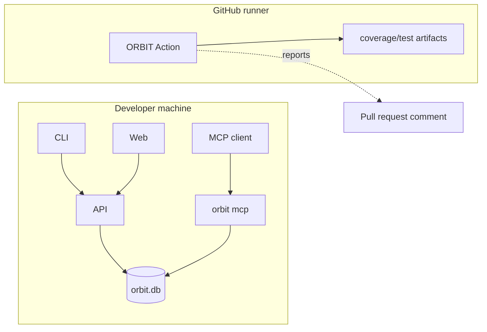

# ORBIT — Technical Design (Prompt 1)

Version: 1.0 · Date: 2026-11-07
Supersedes the provisional choices in `docs/ARCHITECTURE.md` §6 and §10. Where the two disagree, this document wins. Decisions are recorded in `docs/DECISIONS/` (this repo keeps ADRs there rather than `docs/adr/`).

## 1. Verified toolchain (checked against the npm registry on 2026-11-07)

| Tool | Version pinned | Why this version |
|---|---|---|
| Node.js | 22 LTS (>= 22.12) | Installed here: 22.23.4. Vite 8 and Vitest 5 need `^22.12`; better-sqlite3 13 needs `>=22` |
| pnpm | 10.28.0 | The installed version; newer majors exist (registry shows 12.x) but 10.x is what is verified to work in this environment. Pinned through `packageManager` |
| TypeScript | **6.0.3** | Registry `latest` is 7.0.2, but `typescript-eslint` 8.72.1 declares `typescript >=4.8.4 <6.1.0`. Using 7.x would break linting, so we pin the newest 6.0.x |
| Turborepo | 2.11.10 | |
| Vitest | 5.1.0 | |
| ESLint / typescript-eslint | 10.14.0 / 8.72.1 | |
| Prettier | 3.9.10 | |
| Fastify | 5.12.8 | |
| Drizzle ORM / Kit | 0.45.4 / 0.31.11 | |
| better-sqlite3 | 13.0.3 | Installed and loaded successfully in this environment (SQLite 3.53.4) |
| Commander | 15.1.0 | |
| Vite / @vitejs/plugin-react | 8.3.6 / 6.2.1 | |
| React | 19.3.1 | |
| Tailwind CSS / @tailwindcss/vite | 4.3.5 | |
| pino | 10.4.0 | Structured logging |
| zod | 4.6.7 | Config and input validation |
| MCP TypeScript SDK | 1.32.2 (latest at check time) | Not installed yet; Prompt 5. Earlier research cited 1.27.1; the registry is newer. Re-verify the v2 branch status before installing |

Versions are re-verified at install time in each prompt. They are recorded in `ORBIT_BUILD_STATE.md`.

## 2. Package boundaries and dependency rules

```mermaid
flowchart TD
  subgraph apps
    web[apps/web]
    api[apps/api]
    cli[apps/cli]
  end
  subgraph engines
    atlas
    witness
    flare
    capsule
    fr[flight-recorder]
    mcp
    ai
    github
  end
  evidence --> graph --> core
  graph --> database
  core --> shared
  database --> shared
  atlas & witness & flare & capsule & fr --> core
  atlas & witness & flare & capsule & fr --> database
  evidence --> atlas & witness & flare & capsule & fr
  api --> evidence & mcp & ai & github
  cli --> api
  mcp --> evidence
  ai --> evidence
  github --> witness & evidence
  web --> ui --> shared
  web -. HTTP .-> api
```

Rules (enforced later by lint boundaries in Prompt 16):

1. `shared` imports nothing from ORBIT.
2. Engines (`atlas`, `witness`, `flare`, `capsule`, `flight-recorder`) never import each other. They communicate through graph nodes/edges/evidence in `core`/`database`.
3. Only `evidence` joins data across engines.
4. `apps/web` talks to `apps/api` over HTTP only; it never imports `database` or any engine.
5. No package opens network connections except `github` and `ai`, and only when configured.

**Packages created in Prompt 2:** `shared`, `database`, `apps/api`, `apps/cli`, `apps/web`. Others are created in the prompt that implements them, so no empty scaffolds exist.

## 3. Resolved design questions

| Question (from ARCHITECTURE.md §10 / DATA_MODEL.md §10) | Decision |
|---|---|
| SQLite file layout | One database per workspace (default `.orbit/orbit.db` in the registered root, overridable with `ORBIT_DB_PATH`). Repositories are separated by `repositoryId`; no cross-repo queries unless requested explicitly |
| SQLite driver | better-sqlite3 via Drizzle. Node's built-in `node:sqlite` also works but is marked experimental in Node 22 and prints a warning (ADR-0008) |
| Module system | ESM everywhere, `module: NodeNext` for Node packages, `Bundler` resolution for the web app |
| Package output | Each package builds to `dist/` with `tsc`; consumers import built output through `exports`. Turbo runs `^build` before dependents' dev/test/typecheck |
| Symbol identity | `repositoryId + path + qualified name + kind`. Rename tracking (SUPERSEDES edges with similarity evidence) is deferred to Prompt 4 and must be labelled as heuristic |
| Serial library | Deferred to Prompt 9. File replay is implemented first; serial is an optional transport so a missing native module never breaks the rest |
| GitHub Action packaging | Bundled JavaScript action (esbuild single file) so users need no install step; decided in Prompt 13 |
| API exposure | `127.0.0.1` only, `Host` header allowlist against DNS rebinding, per-session token added with the first write endpoints |

## 4. Core contracts (draft, implemented from Prompt 3)

```ts
type EvidenceStatus = 'PASS' | 'FAIL' | 'PARTIAL' | 'NOT_MEASURED' | 'INCOMPLETE';

interface EngineResult {
  nodes: NodeInput[];
  edges: EdgeInput[];
  evidence: EvidenceInput[];
  findings: FindingInput[];
  unsupported: { what: string; reason: string }[]; // explicit gaps
}

interface Engine<I> {
  readonly id: EngineId;
  run(input: I, ctx: EngineContext): Promise<EngineResult>;
}

interface EngineContext {
  repositoryId: string;
  store: GraphStore;       // append-only writes
  logger: Logger;
  signal: AbortSignal;
  limits: { maxFileBytes: number; maxDepth: number };
}
```

Adapter interfaces: `LanguageParser`, `CoverageAdapter`, `TestReportAdapter`, `TelemetryTransport`, `TelemetryParser`, `AIProvider`. Every adapter ships a shared contract-test suite.

## 5. Cross-engine interfaces

| From → To | Mechanism | Data |
|---|---|---|
| WITNESS → ATLAS | graph query | changed file lines → symbols → impacted nodes and related tests |
| WITNESS → FLARE | graph query | related test IDs → reliability history |
| Evidence → CAPSULE | graph query | commit → environment manifest/fingerprint |
| Evidence → FLIGHT RECORDER | graph query | firmware build ID / commit → telemetry sessions |
| API/CLI/MCP/Action → engines | `@orbit/*` public functions | validated inputs, bounded outputs |

No engine calls another engine's code directly.

## 6. Local API surface (Prompt 2 shell → Prompt 11 full)

| Method | Path | Prompt 2 status |
|---|---|---|
| GET | `/health` | Implemented: status, version, database connectivity and schema version |
| GET/POST | `/repositories` … | Prompt 11 |

Responses use a shared `HealthResponse` type from `@orbit/shared`.

## 7. Database design (Prompt 2 minimum)

A `meta` key/value table and a migration runner (Drizzle migrator, SQL files generated by drizzle-kit and committed). PRAGMAs on open: `journal_mode = WAL`, `foreign_keys = ON`, `busy_timeout`. Graph tables arrive in Prompt 3.

## 8. Entity relationships (target, Prompt 3)

```mermaid
erDiagram
  REPOSITORY ||--o{ NODE : owns
  REPOSITORY ||--o{ EVIDENCE : owns
  NODE ||--o{ EDGE : from
  NODE ||--o{ EDGE : to
  EVIDENCE ||--o{ NODE : supports
  EVIDENCE ||--o{ EDGE : supports
  EVIDENCE ||--o{ FINDING : supports
  EVIDENCE ||--o{ PASSPORT : referenced_by
  LEDGER ||--|| EVIDENCE : chains
```

## 9. Deployment views



## 10. Risks specific to this design

| Risk | Mitigation |
|---|---|
| TypeScript 6.0 is pinned behind the registry latest | Revisit when typescript-eslint supports 7.x (ADR-0007) |
| Native module (better-sqlite3) install failures on some platforms | Prebuilt binaries are used, no compile (ADR-0008). CI matrix on Windows/macOS/Linux; fallback to `node:sqlite` if needed |
| pnpm 10 blocks dependency build scripts by default | Explicit allow/ignore lists in `pnpm-workspace.yaml` (esbuild allowed; better-sqlite3 ignored because it ships prebuilds) |
| Many packages slow down early iteration | Create packages only when implemented |
